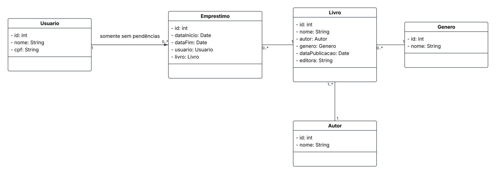

# Biblioteca Web Frontend

Frontend do sistema de empréstimo de livros, construído com React (+ Vite), TypeScript e Mantine.
Os dados vêm da API REST do backend `library-backend` (Spring Boot), que fica em um repositório irmão.
Este é o ponto de partida para quem vai criar componentes, corrigir telas ou revisar código.

A documentação detalhada está indexada em [`docs/INDEX.md`](docs/INDEX.md).

## Sumário

- [Começando](#começando)
- [Rodando junto com o backend](#rodando-junto-com-o-backend)
- [Comandos disponíveis](#comandos-disponíveis)
- [Telas](#telas)
- [Rodando com Docker](#rodando-com-docker)
- [Estrutura do projeto](#estrutura-do-projeto)
- [Usando o Mantine](#usando-o-mantine)
- [Estilização e customização](#estilização-e-customização)
- [Usando ferramentas de IA](#usando-ferramentas-de-ia)
- [Regras de contribuição](#regras-de-contribuição)
- [Como enviar seu código](#como-enviar-seu-código)
- [Checklist antes de enviar](#checklist-antes-de-enviar)
- [Modelo de dados](#modelo-de-dados)

## Começando

### Pré-requisitos

- Node.js 20.19 ou superior (recomendado o 22, o mesmo da imagem Docker, que usa `node:22-alpine`). O Vite 8 exige 20.19+ ou 22.12+, e o ESLint 10 exige 20.19+, 22.13+ ou 24+; por isso, no Node 22, use a partir da 22.13.
- npm
- Git
- Backend `library-backend` (repositório irmão, em `../library-backend`) para ter dados reais: Java 21 e Maven. Veja [Rodando junto com o backend](#rodando-junto-com-o-backend).
- Docker, caso queira validar a imagem de produção ou subir o container do frontend

### Instalação local

Clone o repositório e entre na pasta do projeto:

```bash
git clone <url-do-repositorio>
cd biblioteca-web-frontend
```

Instale as dependências:

```bash
npm install
```

Inicie o servidor de desenvolvimento:

```bash
npm run dev
```

Abra o endereço mostrado no terminal, normalmente `http://localhost:5173`.

O Vite atualiza a página automaticamente enquanto você edita os arquivos.

Sem o backend no ar, a aplicação abre, mas mostra o alerta "Não foi possível carregar os dados" com o botão "Tentar novamente".

### Configuração do ambiente

As variáveis ficam em `.env.example`. Para mudar algo, copie o arquivo para `.env.local` (ignorado pelo Git) e reinicie o `npm run dev`:

```bash
cp .env.example .env.local
```

| Variável | Padrão | Para que serve |
| --- | --- | --- |
| `VITE_API_URL` | `/api` | URL base da API usada pelo navegador. É embutida no bundle em tempo de build. Com `/api`, as chamadas passam pelo proxy (Vite em desenvolvimento, Nginx na imagem Docker), que remove o prefixo `/api` antes de repassar ao backend. |
| `VITE_PROXY_TARGET` | `http://localhost:8080` | Destino do proxy do Vite em `npm run dev` e `npm run preview`. Só é lida pelo `vite.config.ts`; não vai para o bundle. |

Mantenha `VITE_API_URL=/api`. Com uma URL absoluta (ex.: `http://localhost:8080`) o navegador chama o backend direto, sem o proxy, e o backend só aceita as origens liberadas no CORS (por padrão `http://localhost:5173` e `http://localhost:4173`).

## Rodando junto com o backend

O backend é o repositório irmão `library-backend` (Spring Boot, Java 21, banco H2 em memória). Os dois repositórios devem ficar lado a lado:

```text
faculdade/
├── biblioteca-web-frontend/
└── library-backend/
```

Em dois terminais:

```bash
# Terminal 1: backend na porta 8080
cd ../library-backend
mvn spring-boot:run

# Terminal 2: frontend na porta 5173
cd ../biblioteca-web-frontend
npm run dev
```

- O backend sobe com dados de exemplo (12 autores, 9 gêneros, 20 livros, 10 usuários e 14 empréstimos). Como o H2 é em memória, tudo volta ao estado inicial a cada reinício do backend.
- O navegador chama `/api/...` no próprio servidor do Vite, que repassa para `VITE_PROXY_TARGET` sem o prefixo `/api` (`/api/authors` vira `http://localhost:8080/authors`). Se o backend estiver em outro endereço: `VITE_PROXY_TARGET=http://192.168.0.10:8080 npm run dev`.
- O proxy também remove o header `Origin` das requisições. Sem isso, escritas (POST, PUT, PATCH e DELETE) feitas por uma origem não liberada no CORS (ex.: `http://127.0.0.1:5173`) seriam recusadas pelo backend com 403.
- Detalhes de como o frontend consome a API (erros, recarga de dados, tabela de endpoints): [`docs/integracao/api.md`](docs/integracao/api.md).

## Comandos disponíveis

| Comando | Para que serve |
| --- | --- |
| `npm run dev` | Inicia o Vite em modo de desenvolvimento. |
| `npm run format` | Formata arquivos TypeScript, TSX e CSS com Prettier. |
| `npm run lint` | Verifica problemas de ESLint. |
| `npm run build` | Executa o TypeScript e gera a versão de produção. |
| `npm run preview` | Serve localmente o build já gerado. |

Ainda não existe um framework de testes automatizados configurado. Por enquanto, valide o comportamento no navegador e execute `npm run lint` e `npm run build` antes de enviar alterações.

## Telas

A navegação fica no menu lateral (no celular, abre pelo botão de menu). Todas as telas leem os dados da API e recarregam apenas o que mudou depois de cada cadastro, edição ou exclusão.

| Tela | O que mostra e faz |
| --- | --- |
| Dashboard | Cartões com total de livros, empréstimos ativos, empréstimos em atraso e total de autores, mais atalhos para cadastrar livro, cadastrar autor e registrar empréstimo. |
| Livros | Tabela com título, gênero, autor, lançamento, editora e situação (Disponível ou Emprestado). Cadastro e edição escolhem autor e gênero em listas pesquisáveis. A exclusão pede confirmação e avisa quando o livro é o último do autor. |
| Autores | Tabela com nome e quantidade de livros, com cadastro, edição e exclusão. Autor sem livros aparece com a etiqueta "Sem livros": pela regra do acervo, todo autor deve ter ao menos um livro, mas o cadastro não é bloqueado. |
| Usuários | Tabela com nome, CPF formatado e situação (Sem pendências ou Com pendências), com cadastro, edição e exclusão. O CPF pode ser digitado com ou sem pontuação; o backend valida os dígitos e recusa CPF repetido. |
| Empréstimos | Tabela com livro, usuário, início, devolução prevista, "Devolvido em" e status (Ativo, Atrasado ou Concluído), com filtro por status. "Novo Empréstimo" lista só livros disponíveis e desabilita usuários com pendências. "Registrar devolução" abre um modal para informar a data efetiva (padrão: hoje; aceita data retroativa, entre o início do empréstimo e hoje). |

O status do empréstimo, a pendência do usuário (`debtFree`) e a disponibilidade do livro (`available`) são calculados pelo backend; o frontend só exibe.

Limitações conhecidas:

- Não existe tela de Gêneros. Os gêneros vêm da API e alimentam o seletor de livros; o `genreService` já tem o CRUD completo, mas nenhuma tela o usa. Sem a tela, o catálogo fica limitado aos gêneros do seed.
- Não existe exclusão de empréstimo (o backend também não oferece); um empréstimo termina com a devolução.

## Rodando com Docker

O `Dockerfile` usa dois estágios: primeiro instala as dependências e gera o build (`node:22-alpine`); depois copia o resultado para um Nginx (`nginx:1.30-alpine`) que serve o SPA e faz proxy de `/api/` para o backend, removendo o prefixo `/api` e o header `Origin`.

Detalhes (template do Nginx, variáveis, cache de build, tamanho e checksum da imagem): [`docs/docker/imagem.md`](docs/docker/imagem.md).

### Construir a imagem

```bash
docker build -t biblioteca-web-frontend .
```

Para gerar também o arquivo `.tar.gz` com o `.sha256` (pasta `images/`, ignorada pelo Git), use o script:

```bash
scripts/build-image.sh            # tag automática (git describe) e latest
scripts/build-image.sh 1.0.0      # tag explícita
```

### Com o docker-compose

O `docker-compose.yml` deste repositório sobe **só o frontend**. O backend tem o próprio `docker-compose.yml`, no repositório `library-backend`. Os dois containers ficam separados e se enxergam pela rede Docker `biblioteca-net`, que precisa existir (crie uma vez):

```bash
docker network create biblioteca-net
docker compose up -d --build                              # aqui: sobe o frontend em http://localhost:8081
(cd ../library-backend && docker compose up -d --build)   # no repositório do backend: sobe a API em http://localhost:8080
```

O frontend sobe mesmo sem o backend; as chamadas `/api` respondem 502 até a API ficar de pé. Para derrubar, rode `docker compose down` em cada repositório.

### Iniciar só o container do frontend

O Nginx precisa alcançar o backend. Por padrão ele procura `http://library-backend:8080`, nome que só resolve em uma rede Docker onde exista um container (ou alias) `library-backend`. Com o backend rodando na máquina (porta 8080), aponte o proxy para o IP do host; no Linux, o IP da bridge do Docker costuma ser `172.17.0.1`:

```bash
docker run --rm -p 8081:80 -e API_UPSTREAM=http://172.17.0.1:8080 biblioteca-web-frontend
```

Abra `http://localhost:8081` no navegador. Para parar, pressione `Ctrl+C` no terminal. Sem backend alcançável, a página abre, mas mostra "Não foi possível carregar os dados" (o proxy responde 502).

### Validar a versão do container

Depois de iniciar o container, confira:

1. A página abre em `http://localhost:8081` e os dados carregam (sem o alerta de erro).
2. Não há erros no console do navegador.
3. Os botões, formulários e navegação da alteração funcionam, inclusive uma escrita (ex.: cadastrar um autor).
4. O layout funciona em uma janela estreita e em uma janela larga.

O build usado pelo Docker também pode ser validado sem container com (o `preview` usa a porta 4173 e o mesmo proxy `/api` do desenvolvimento):

```bash
npm run build
npm run preview
```

## Estrutura do projeto

```text
src/
├── App.tsx                  # Casca da aplicação (AppShell), navegação entre telas, modais e exclusões
├── main.tsx                 # Entrada do React, MantineProvider, Notifications e locale do Day.js
├── vite-env.d.ts            # Tipos das variáveis de ambiente (VITE_API_URL)
├── pages/                   # Uma página por tela
│   ├── DashboardPage.tsx
│   ├── BooksPage.tsx        # + BooksPage.module.css (ações da linha visíveis ao passar o mouse)
│   ├── AuthorsPage.tsx
│   ├── UsersPage.tsx
│   ├── LoansPage.tsx
│   └── TableRow.module.css  # Mesmo efeito de hover para Autores e Usuários
├── components/              # Modais de formulário e seus hooks, cartões do dashboard
│   ├── GenericModal.tsx
│   ├── BookFormModal.tsx    # + useBookForm.ts
│   ├── AuthorFormModal.tsx  # + useAuthorForm.ts
│   ├── UserFormModal.tsx    # + useUserForm.ts
│   ├── LoanFormModal.tsx    # + useLoanForm.ts
│   ├── ReturnLoanModal.tsx  # + useReturnLoanForm.ts
│   ├── StatsCard.tsx
│   └── StatusContainer.tsx
├── hooks/
│   └── useLibraryData.ts    # Carrega os dados da API e recarrega só o necessário (refresh)
├── services/                # Única camada que fala com a API
│   ├── api.ts               # Cliente HTTP (fetch), ApiError, getErrorMessage, isOutdatedDataError
│   ├── authorService.ts
│   ├── bookService.ts       # Mapeia publishDate (API) <-> publicationDate (front)
│   ├── genreService.ts
│   ├── loanService.ts       # Mapeia o recurso /lendings da API para o tipo Loan
│   ├── userService.ts
│   └── mockData.ts          # Mocks antigos, mantidos só como referência (não é importado)
├── types/                   # Tipos e DTOs compartilhados (book.ts, loan.ts, user.ts)
└── utils/
    ├── feedback.ts          # Notificações e erros de campo vindos da API nos formulários
    └── format.ts            # Datas (ISO <-> DD/MM/YYYY) e CPF

nginx/                       # Template do Nginx da imagem Docker (serve o SPA e faz proxy de /api)
scripts/                     # build-image.sh: gera a imagem Docker e o .tar.gz com checksum
docs/                        # Documentação e imagens do projeto (comece por docs/INDEX.md)
public/                      # Arquivos públicos servidos sem processamento
Dockerfile                   # Build em dois estágios: Vite (Node) e Nginx
.env.example                 # Variáveis de ambiente (VITE_API_URL, VITE_PROXY_TARGET)
vite.config.ts               # Plugin do React e proxy /api (dev e preview)
```

Ao criar novos arquivos, mantenha cada responsabilidade no lugar mais próximo dela. Tipos que são usados por várias telas devem ficar em `src/types`; chamadas para API devem ficar em `src/services` (componentes e páginas nunca chamam `fetch` direto); componentes reutilizáveis podem ser organizados em uma pasta própria quando essa necessidade aparecer. A pasta `src/assets/` ainda não existe: crie-a quando houver imagens ou outros recursos importados pelo código.

## Usando o Mantine

Os estilos base do Mantine já são carregados em `src/main.tsx`:

```tsx
import { Button, Container, Title } from '@mantine/core';

export function BookHeader() {
	return (
		<Container size="lg" py="xl">
			<Title order={1}>Livros</Title>
			<Button mt="md">Adicionar livro</Button>
		</Container>
	);
}
```

Prefira componentes do Mantine em vez de criar HTML e CSS do zero quando já existir um componente adequado. Alguns componentes úteis:

- Layout: `Container`, `Grid`, `Stack`, `Group`, `Flex`, `SimpleGrid`
- Conteúdo: `Title`, `Text`, `Badge`, `Paper`, `Card`, `Alert`
- Formulários: `TextInput`, `Select`, `DateInput`, `Checkbox`, `Button`
- Feedback: `Modal`, `Notification`, `LoadingOverlay`, `Loader`
- Dados: `Table`, `Pagination`, `Tabs`

Consulte a documentação oficial para ver propriedades, exemplos e acessibilidade: <https://mantine.dev/>

### Espaçamento e propriedades responsivas

Use as propriedades do Mantine para espaçamento e layout:

```tsx
<Stack gap="md">
	<TextInput label="Título" placeholder="Digite o título" />
	<Group justify="flex-end">
		<Button>Salvar</Button>
	</Group>
</Stack>
```

Muitas propriedades aceitam valores responsivos. Quando necessário, use `Grid` ou os hooks do Mantine para adaptar a tela a diferentes tamanhos.

### Datas

O projeto já possui `@mantine/dates`, `dayjs` e a localidade `pt-br` configurados. Para campos de data, importe os estilos de datas já carregados em `main.tsx` e siga os exemplos da documentação do Mantine.

Hoje os formulários usam `TextInput type="date"`, cujo valor já é uma string ISO `YYYY-MM-DD`, o mesmo formato da API. Datas trafegam sempre em ISO e só são formatadas para exibição (`DD/MM/YYYY`) com o Day.js, pelo `formatDate` de `src/utils/format.ts`.

## Estilização e customização

Para uma alteração simples, priorize as props de estilo do componente:

```tsx
<Button color="blue" variant="filled" radius="sm" size="md">
	Salvar
</Button>
```

Para estilos locais, use `className` ou `classNames` com um arquivo CSS próximo ao componente. Evite estilos globais sem necessidade.

Para customizar o tema da aplicação, configure o `MantineProvider` em `src/main.tsx`. Exemplo:

```tsx
<MantineProvider
	theme={{
		primaryColor: 'blue',
		defaultRadius: 'sm',
	}}
>
	<App />
</MantineProvider>
```

Não remova `@mantine/core/styles.css` nem `@mantine/dates/styles.css`. Sem esses imports, componentes do Mantine podem aparecer sem o estilo correto.

## Usando ferramentas de IA

As instruções para ferramentas de IA podem ficar na raiz do projeto, em:

```text
AGENTS.md
```

Esse é o local recomendado para regras gerais que qualquer agente deve seguir, como:

- Usar nomes de variáveis em inglês.
- Respeitar o Prettier e a estrutura das pastas.
- Usar Mantine antes de criar componentes ou estilos do zero.
- Buscar dados sempre pela camada `src/services`, nunca com `fetch` direto em componentes.
- Executar `npm run format`, `npm run lint` e `npm run build` antes de concluir.
- Não inventar APIs, dependências ou arquivos que não sejam necessários.

O `CLAUDE.md` da raiz contém apenas `@AGENTS.md`: é o jeito de o Claude Code carregar essas mesmas regras, sem duplicar texto.

Para instruções específicas do GitHub Copilot, também pode ser usado:

```text
.github/copilot-instructions.md
```

Neste projeto, a sugestão é colocar as regras compartilhadas em `AGENTS.md` e usar `.github/copilot-instructions.md` somente para orientações exclusivas do Copilot. Não duplique regras nos dois arquivos sem necessidade, porque elas podem ficar diferentes com o tempo.

Exemplo de organização:

```text
AGENTS.md                         # Regras gerais para agentes de IA
.github/copilot-instructions.md   # Regras específicas do GitHub Copilot
```

Os arquivos de instrução devem ser versionados junto com o projeto. Não coloque neles senhas, tokens, chaves de API ou informações privadas.

## Regras de contribuição

- Variáveis, funções, componentes, interfaces e propriedades novas devem usar nomes em inglês.
- Textos visíveis para o usuário podem ficar em português.
- Siga a formatação do Prettier. Rode `npm run format` antes de enviar.
- Use TypeScript e evite `any` quando um tipo puder ser definido.
- Os dados vêm da API: chamadas HTTP ficam em `src/services`, e o mapeamento entre o formato do backend e o do frontend também (ex.: `publishDate` <-> `publicationDate`). Não chame `fetch` direto em componentes e não importe `src/services/mockData.ts`.
- Avisos de sucesso e erro usam `notifySuccess` e `notifyError` de `src/utils/feedback.ts`; erros de validação da API nos formulários usam `handleFormError`.
- Prefira componentes pequenos e reutilizáveis.
- Não envie código quebrado, imports não utilizados ou `console.log` de teste.
- Não altere configurações globais sem explicar a necessidade na descrição da alteração.
- Preserve acessibilidade: use labels nos campos, botões para ações e elementos semânticos.

## Como enviar seu código

### 1. Atualize sua cópia

```bash
git switch main
git pull origin main
```

### 2. Crie uma branch

Uma branch é uma cópia de trabalho separada. Dê um nome curto e em inglês, por exemplo:

```bash
git switch -c feature/book-form
```

Outros exemplos: `fix/mobile-layout` e `chore/update-dependencies`.

### 3. Faça a alteração e confira o resultado

```bash
npm run format
npm run lint
npm run build
```

Teste também a tela no navegador e, quando a alteração afetar o build final, rode o Docker.

### 4. Veja o que mudou

```bash
git status
git diff
```

`git status` mostra arquivos alterados. `git diff` mostra o conteúdo das alterações. Leia o diff antes de continuar para evitar enviar arquivos acidentais.

### 5. Salve a alteração em um commit

```bash
git add src/caminho/do/arquivo.tsx
git commit -m "Add book form"
```

Adicione somente os arquivos relacionados à tarefa. A mensagem deve explicar a mudança de forma curta, em inglês.

### 6. Envie a branch

```bash
git push -u origin feature/book-form
```

Depois, abra um Pull Request no GitHub. Na descrição, informe:

- O que foi alterado.
- Como testar.
- Prints ou vídeo, quando houver mudança visual.
- Se existe algum ponto pendente ou decisão que precisa de revisão.

Se você não souber Git, pode seguir exatamente os comandos acima. Em caso de conflito ou mensagem de erro, não apague arquivos nem use comandos destrutivos: envie a mensagem completa para o grupo.

## Checklist antes de enviar

- [ ] Os nomes novos estão em inglês.
- [ ] Rodei `npm run format`.
- [ ] Rodei `npm run lint` sem erros.
- [ ] Rodei `npm run build` sem erros.
- [ ] Testei a tela no navegador, contra o backend real (`library-backend`).
- [ ] Testei estados importantes: carregamento, vazio, erro (inclusive com a API parada) e sucesso, quando aplicável.
- [ ] Conferi a versão mobile e desktop.
- [ ] Revisei `git diff` e não incluí arquivos que não fazem parte da tarefa.
- [ ] Atualizei a documentação (`README.md`, `AGENTS.md`, `docs/` e o `docs/INDEX.md`) se a alteração exigir isso.

## Modelo de dados

O Diagrama de Entidade-Relacionamento (DER) está em `docs/der.png`:



Os tipos atuais ficam em `src/types` e são a fonte de verdade para o código do frontend. Quando um tipo for compartilhado entre telas ou serviços, adicione-o nessa pasta em vez de duplicar a definição.

| Arquivo | Tipos |
| --- | --- |
| `src/types/book.ts` | `Author`, `AuthorWithBookCount` (com `bookCount`), `Genre`, `GenreWithBookCount`, `Book`, `CreateBookDTO`, `CreateAuthorDTO`, `CreateGenreDTO` |
| `src/types/user.ts` | `User` (com `debtFree`), `CreateUserDTO` |
| `src/types/loan.ts` | `Loan`, `LoanStatus` (`'ATIVO' \| 'CONCLUIDO' \| 'ATRASADO'`), `CreateLoanDTO`, `ReturnLoanDTO` |

O DER descreve as entidades do domínio (Usuário, Empréstimo, Livro, Gênero e Autor). A aplicação acrescenta campos calculados pelo backend, que o frontend apenas exibe:

- `Loan.returnDate`: data efetiva da devolução (`null` enquanto o livro não foi devolvido).
- `Loan.status`: `ATIVO`, `ATRASADO` (prazo vencido e sem devolução) ou `CONCLUIDO` (devolvido).
- `Book.available`: `true` quando o livro não tem empréstimo em aberto.
- `User.debtFree`: `false` quando o usuário tem empréstimo em atraso; esse usuário não pode fazer novos empréstimos.
- `bookCount` em autores e gêneros: quantidade de livros vinculados.

Diferenças de nome entre a API e o frontend (resolvidas nos services): o livro usa `publishDate` na API e `publicationDate` no frontend, e empréstimos são o recurso `/lendings` da API (tipo `Loan` no frontend). A tabela completa está em [`docs/integracao/api.md`](docs/integracao/api.md).
